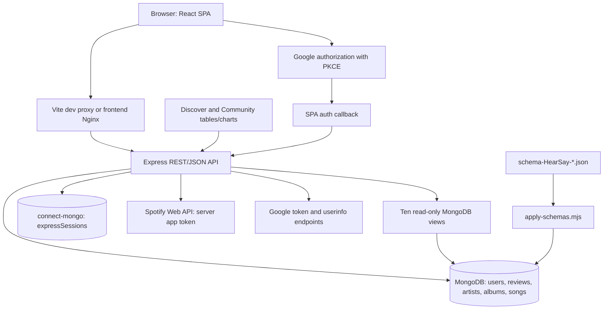
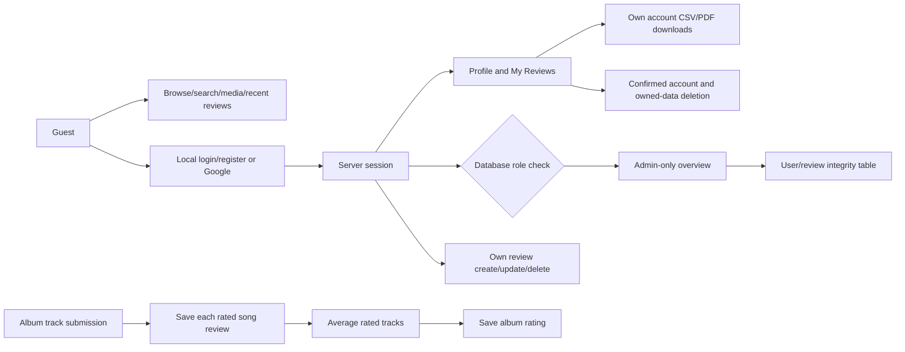

# Current architecture

This page and [site-diagram.puml](site-diagram.puml) describe the current code.

Native development serves Vite on 5173 and Express on 5174. Docker publishes
frontend Nginx on 8080, Express on 5174 and MongoDB on 27017. The optional Nginx
Proxy Manager handles public HTTP/HTTPS only when configured separately.

At least one track is required. Song records are saved separately. Writes are sequential
and not transactional. Guests on protected routes redirect to auth; guests
submitting on public media pages are rejected by the API and usually see alerts.

Startup seeds the configured default administrator only when no default admin exists.
The Admin page and its API require the persisted admin role; cached client state cannot
authorize access. Account exports exclude credentials. Account deletion removes owned
reviews, references and sessions while retaining shared music metadata; a durable marker
allows retrying incomplete cleanup on the standalone MongoDB deployment.

The ten Phase II view definitions are installed/reconciled during backend startup. Public Discover/Community APIs query MongoDB views with validated search, filters, paging and chart facets. The integrity view uses the existing admin role middleware. See [view-to-page mapping](ANALYTICAL_VIEWS.md).

## Historical rendered diagrams

The existing PNGs are retained as historical design snapshots, not current
implementation references:

| Artifact | Description |
| --- | --- |
| site-diagram.png | Earlier component-design snapshot |
| high-level.png | Earlier conceptual site structure |
| flow.png | Earlier conceptual navigation flow |

Use the diagrams above or the updated PlantUML source for current architecture figures.
The PNGs were inspected but not regenerated; their historical status is explicit
to avoid presenting old behavior as the current app.
