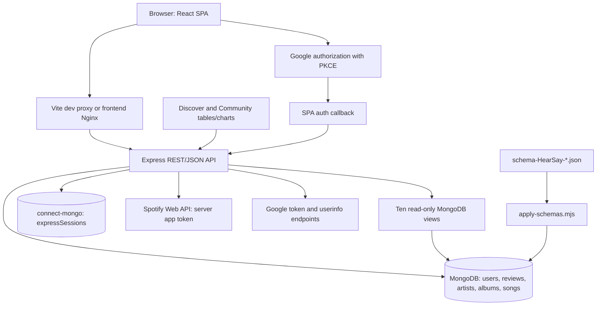
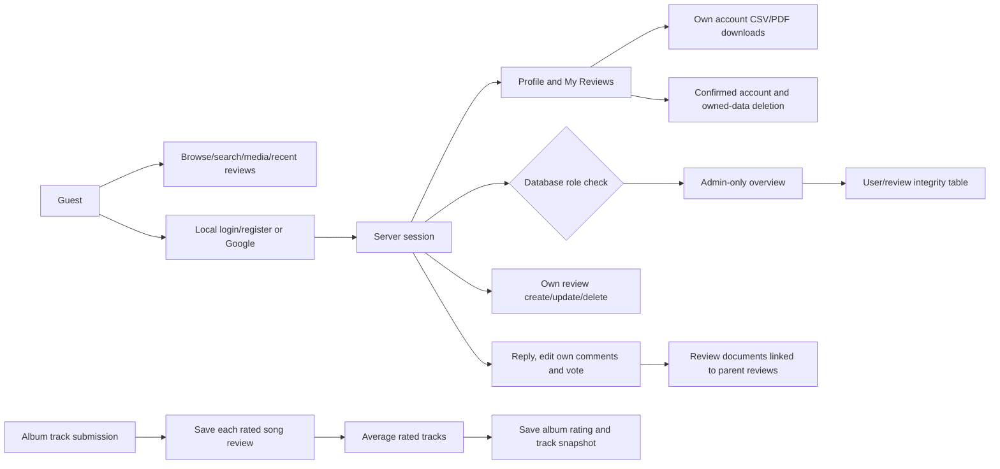

# Current architecture

This page and [site-diagram.puml](site-diagram.puml) describe the current code.

Native development serves Vite on 5173 and Express on 5174. The main Compose
stack binds the frontend (8080), Express (5174), MongoDB (27017), and Nginx Proxy
Manager's admin UI (8181) to host loopback. The optional Cloudflare Tunnel
routes public traffic to Nginx Proxy Manager over the Docker network. See
[production setup](../README.md#production-setup-online-access).

At least one track is required. The album review stores a `trackRatings` array of
`{ trackId, rating }` entries. Individual song reviews supply song-level ratings.
Writes are sequential
and not transactional. Guests on protected routes redirect to auth; guests
submitting on public media pages are rejected by the API and usually see alerts.

Startup seeds the configured default administrator only when no default admin exists.
The Admin page and its API require the persisted admin role; cached client state cannot
authorize access. Account exports exclude credentials. Account deletion removes owned
review threads, votes, references and sessions while retaining shared music metadata.
Comments within other users' threads become anonymous placeholders. A durable marker
allows retrying incomplete cleanup on the standalone MongoDB deployment.

Backend startup reconciles analytical MongoDB views. Discover/Community query them through public endpoints; the integrity view requires the admin middleware. See [API contracts](BACKEND_REFERENCE.md#analytical-queries).

Comments share the reviews collection and reference an immediate parent plus a thread root. The backend serializes discussion writes in one process; deleting a media review removes its subtree, while deleting a comment preserves its descendants. Media-review feeds and activity rankings exclude comments. The read-only `db:validate` command checks schema and relationship consistency.

## Historical rendered diagrams

The existing PNGs are retained as historical design snapshots, not current
implementation references:

| Artifact | Description |
| --- | --- |
| site-diagram.png | Earlier component-design snapshot |
| high-level.png | Earlier conceptual site structure |
| flow.png | Earlier conceptual navigation flow |

Use the Mermaid diagrams above or the PlantUML source for current architecture.
